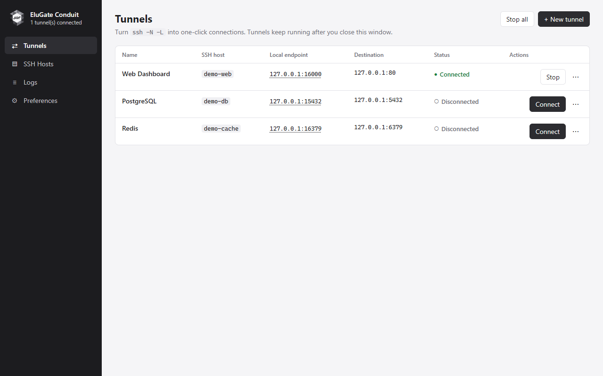
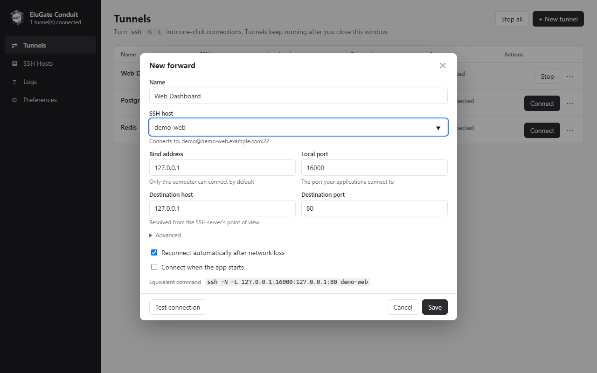
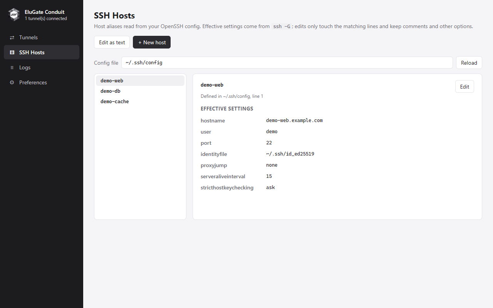
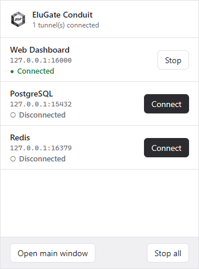

<p align="center">
  
</p>

# EluGate Conduit

**Your SSH tunnels, in one place.**

English · [繁體中文](README.zh-TW.md)

EluGate Conduit is an open-source desktop SSH tunnel manager by **伊露科技有限公司 Elu Technology Ltd.** It turns `ssh -N -L` into saved connection profiles, a visual editor, and a system tray quick panel.

Built with **Rust**, **Tauri 2**, **React**, and **TypeScript**, it uses your system's OpenSSH client and existing SSH configuration.

[Download installers](https://github.com/JuroHsu/EluGate_Conduit/releases) · [Company website](https://elu.com.tw/) · [Contact](mailto:service@elu.com.tw) · [MIT license](LICENSE)



> Version 0.2.2 — early development. Windows 11 is the primary validation platform. macOS and Linux support is implemented but has not been validated end to end. See [status and limitations](#status-and-limitations).
>
> Screenshots show the actual React interface rendered in Chromium with example data and simulated connection states. They do not show live SSH sessions. [Screenshot details](docs/screenshots/README.md).

## Features

- **Saved local forwards:** create, edit, duplicate, connect, and stop individual tunnels.
- **Quick access:** control tunnels from the system tray panel; closing the main window keeps connections running.
- **Existing SSH configuration:** use Host aliases, identity files, SSH agent authentication, and `ProxyJump` through OpenSSH.
- **Host editor:** inspect effective settings with `ssh -G`, preview changes, and create a backup before saving. Detects external file changes.
- **SSH identity files:** generate `~/.ssh/id_ed25519` and its public key without replacing existing keys; select IdentityFile with a native file picker when adding or editing a host.
- **Connection diagnostics:** test SSH authentication, local forwarding, and destination reachability as separate stages.
- **Automatic reconnect:** retry eligible connection failures with a 2 → 5 → 10 → 20 → 30 → 60 second backoff.
- **Port conflict handling:** detect overlapping listeners and offer to stop a conflicting managed tunnel before switching.
- **Authentication prompts:** dialogs for host key confirmation, passwords, and key passphrases.
- **Desktop integration:** single instance, optional launch at login, per-tunnel connect on launch, and light/dark appearance following the system.
- **11 interface languages:** English, Traditional Chinese, Simplified Chinese, Japanese, Korean, Spanish, French, German, Brazilian Portuguese, Russian, and Vietnamese.

## Screenshots

### Tunnel editor

Set the local listening endpoint and destination, inspect the equivalent SSH command, and test before saving.



### SSH hosts

Browse Host aliases and inspect the settings OpenSSH will actually use.



### System tray quick panel

Connect or stop a saved tunnel without opening the full management window.



## Getting started

### Requirements

The desktop app needs an installed **OpenSSH client** and access to an SSH server. Windows also needs **Microsoft Edge WebView2 Runtime**. The macOS bundle is configured for macOS 11 or later, subject to the validation limitations below.

Check that SSH is available:

```bash
ssh -V
```

On Windows, the app prefers the built-in OpenSSH client. You can select another executable under **Preferences → OpenSSH**.

Linux x64 packages are built on Ubuntu 22.04 as `.deb`, `.rpm`, and `.AppImage`. They require WebKitGTK 4.1, GTK 3, AppIndicator, and OpenSSH. GNOME needs an AppIndicator extension to display the tray icon. On Linux, use the tray menu to open the main window. Make an AppImage executable and move it to a permanent location before enabling launch at login. Login launches stay in the tray without opening the main window.

Download installers from [GitHub Releases](https://github.com/JuroHsu/EluGate_Conduit/releases) when a release is available. Under **Assets**, choose the Windows x64 `-setup.exe` (language selector), the Traditional Chinese `_zh-TW.msi`, or the macOS `_universal.dmg` (Apple Silicon and Intel). The automatically generated **Source code** archives are not installers. If no release is listed yet, build from source using the steps below.

Windows installers are currently unsigned by a publisher; macOS builds use ad-hoc signing without Apple notarization. The operating system may warn about or block installation/opening. These packages still require the platform validation described below.

### Create your first tunnel

If you need a key, choose **SSH Hosts → Add identity file**. The app uses `ssh-keygen` to create an Ed25519 key without a passphrase and shows the public key and file locations. Add the public key to the server's `authorized_keys`; the private key stays on this computer and is never uploaded. If either target file already exists, the app preserves it and shows a message.

1. Add a Host alias in **SSH Hosts**, or use one already present in `~/.ssh/config` (`%USERPROFILE%\.ssh\config` on Windows).
2. Open **Tunnels → New tunnel** and enter the values below.
3. Choose **Test connection** to check the connection stages, then save.
4. Click **Connect**, verify any host key prompt against a trusted fingerprint, and open your local endpoint.

Example SSH configuration — replace the example host and account with your own:

```sshconfig
Host demo-web
    HostName server.example.com
    User your-user
    Port 22
    IdentityFile ~/.ssh/id_ed25519
```

| Tunnel field | Example |
| --- | --- |
| Name | Web Dashboard |
| SSH host | `demo-web` |
| Local bind address | `127.0.0.1` |
| Local port | `16000` |
| Destination host | `127.0.0.1` |
| Destination port | `80` |

The forwarding portion is equivalent to:

```bash
ssh -N -L 127.0.0.1:16000:127.0.0.1:80 demo-web
```

Visit `http://127.0.0.1:16000` to reach the remote HTTP service. **The destination address is interpreted from the SSH server's perspective**: destination `127.0.0.1:80` means port 80 on that server.

Keep the local bind address at `127.0.0.1` for access from your computer only. Binding to `0.0.0.0` or `::` can expose the forwarded service to other machines, depending on your firewall.

Closing the main window hides it while tunnels continue running. Use **Preferences → Quit application** or the tray menu to stop managed tunnels and exit.

## Development

Install a maintained Node.js LTS release compatible with Vite 5 (Node.js 22+ recommended), npm, and stable Rust. For native builds, follow the [Tauri prerequisites](https://v2.tauri.app/start/prerequisites/): Windows requires the Microsoft C++ build tools and WebView2; macOS requires Xcode Command Line Tools.

From a cloned or downloaded source directory:

On Ubuntu / Debian, install the native build dependencies first:

```bash
sudo apt-get install libwebkit2gtk-4.1-dev build-essential curl wget file libxdo-dev libssl-dev librsvg2-dev libayatana-appindicator3-dev patchelf rpm openssh-client
```

```bash
npm ci
npm run tauri dev
```

`npm run dev` starts only the Vite frontend server. Normal application functionality requires the Tauri backend; the standalone [documentation preview](docs/screenshots/README.md) uses fixtures.

### Checks

Run these from the repository root:

```bash
npm run build
npm test
cargo test --locked --manifest-path src-tauri/Cargo.toml --lib
```

The first command type-checks TypeScript and builds the frontend. Rust unit tests cover tunnel validation, SSH configuration editing, error classification, and translation key consistency. They do not replace end-to-end SSH testing.

### Build installers

Run the command for the host platform:

```bash
# Windows
npm run tauri build -- --bundles nsis,msi

# macOS
npm run tauri build -- --bundles app,dmg

# Linux x64
npm run tauri build -- --bundles deb,rpm,appimage
```

Bundles are written under `src-tauri/target/release/bundle/`. Build each platform's packages on that platform. Release signing and macOS notarization require separate configuration.

Windows MSI builds use Traditional Chinese with code page 950 to preserve the full bilingual company name. NSIS provides a single installer with a selector for 10 languages (all UI languages except Vietnamese).

### Publish a GitHub Release

The [release workflow](.github/workflows/release.yml) builds Windows x64, macOS universal, and Linux x64 installers when a `v<version>` tag is pushed. It publishes the Release only after all three platforms pass, with installers and SHA-256 checksums attached. A manual Actions run on a branch produces test artifacts without publishing.

See the [release guide](docs/RELEASING.md) for first-time setup, version updates, signing limitations, and retries.

### Assets and translations

- Original icons: `design/*.svg`; generated build assets: `src-tauri/icons/`.
- Regenerate icons with `npm run icons` (requires Python and the installed npm dependencies).
- Regenerate installer artwork with `python design/generate_installer_images.py` (requires Pillow).
- Translation files live in `locales/` and are shared by Rust and React.
- To add a language, copy `locales/en.json`, translate its values while preserving keys and placeholders, register it in `src-tauri/src/i18n.rs` (`locales!` and `normalize`) and `src/i18n.tsx` (`LANGUAGES`), then run the Rust tests.
- To update documentation images, follow the [screenshot instructions](docs/screenshots/README.md).

## How it works

The Rust core owns tunnel state and launches one managed OpenSSH process per tunnel. The main window and quick panel send commands to that core and subscribe to its events.

A tunnel is marked connected only after SSH reports authentication and forwarding readiness and the local listener can be reached. Destination health is checked separately; an SSH tunnel can be up while the destination service is unavailable.

Network failures are eligible for automatic reconnection. An unclassified exit after a connection was established can also trigger a retry. Authentication failures, host key changes, configuration errors, and port conflicts stop retries.

| Location | Responsibility |
| --- | --- |
| `src-tauri/src/core.rs` | Tunnel lifecycle, reconnect, switching, and destination checks |
| `src-tauri/src/askpass.rs` | Token-authenticated loopback bridge for SSH authentication prompts |
| `src-tauri/src/proc.rs` | Process ownership and cleanup |
| `src-tauri/src/ssh_config.rs` | Host discovery, effective settings, diff previews, and backups |
| `src-tauri/src/model.rs` | Settings persistence, validation, and migrations |
| `src-tauri/src/tray.rs`, `windows.rs` | Tray and window integration |
| `src/` | React views, dialogs, and frontend API bindings |
| `locales/` | Shared translations |

The [original design proposal](PROJECT_PLAN.md) is retained as historical context, not a guarantee of implemented functionality.

## Local data and troubleshooting

Tunnel profiles and preferences are stored in `config.json` in the platform's application data directory. SSH configuration remains in the selected OpenSSH configuration file. **Preferences → About** shows the actual data and log directories; the **Logs** page can open the log directory.

| Symptom | What to check |
| --- | --- |
| OpenSSH not found | Install the OpenSSH client or set its executable path in Preferences. |
| Local port is already in use | Stop the other listener, select another port, or use the managed tunnel switch action. |
| Connected, but the service is unreachable | Check the destination from the SSH server's network; use the destination check and logs. |
| Authentication fails | Verify the Host alias, account, identity file, SSH agent, and access using the SSH client. |
| Host key changed | Confirm the new fingerprint with the server administrator before updating trust. |

Logs can include host names, user names, file paths, and network addresses. Review and redact logs, screenshots, and configuration before sharing them in an issue.

## Status and limitations

- Current scope is **local TCP forwarding** (`-L`); there is no remote forwarding (`-R`) or dynamic SOCKS forwarding (`-D`) UI.
- Previous project validation records Windows 11 testing for data forwarding, duplicate connection prevention, port conflicts, switching and recovery, destination failure detection, reconnection, host key prompts, and process cleanup.
- macOS behavior, actual password/passphrase entry, multi-monitor and DPI positioning, sleep/resume, installer execution, and signing still need end-to-end validation.
- Linux has `.deb`, `.rpm`, and AppImage release targets; tray integration, native file selection, launch at login, and SSH authentication still need validation across desktop environments.

## Contributing

Bug reports, translations, documentation improvements, and pull requests are welcome.

For bugs, include the app version, operating system, OpenSSH version, reproduction steps, and sanitized logs. Keep pull requests focused, run the checks above, and update both READMEs when changing documented behavior. For sensitive security reports, email [service@elu.com.tw](mailto:service@elu.com.tw) instead of posting credentials or exploit details in a public issue.

## License and company

<a href="https://elu.com.tw/">
  
</a>

Copyright © 2026 **伊露科技有限公司 Elu Technology Ltd.**

Released under the [MIT License](LICENSE). Third-party dependencies retain their respective licenses.

- **Website:** [https://elu.com.tw/](https://elu.com.tw/)
- **Email:** [service@elu.com.tw](mailto:service@elu.com.tw)
