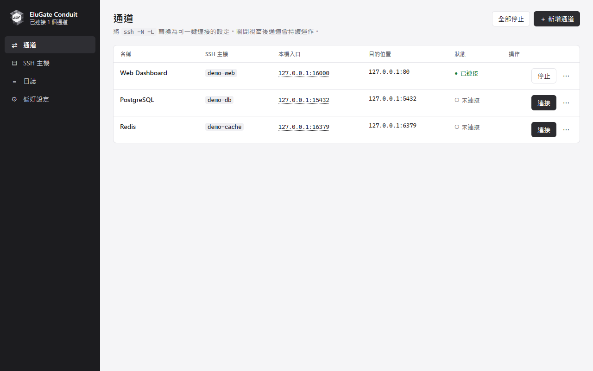
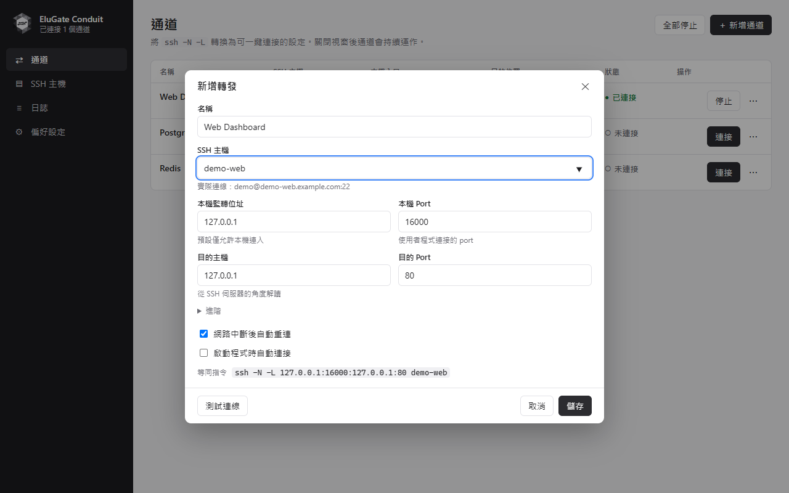
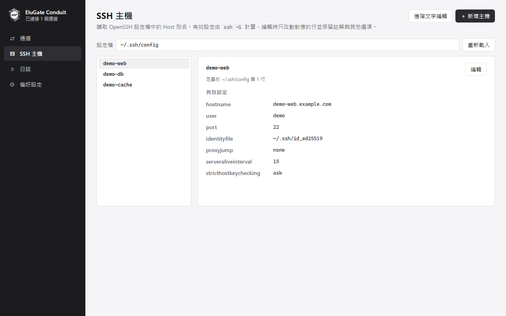
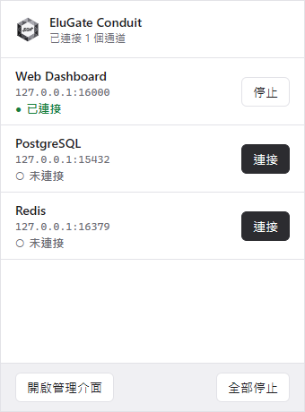

<p align="center">
  
</p>

# EluGate Conduit

**集中管理你的 SSH 通道。**

[English](README.md) · 繁體中文

EluGate Conduit 是由 **伊露科技有限公司 Elu Technology Ltd.** 開發的開源桌面 SSH 通道管理器，將 `ssh -N -L` 轉換成可儲存的連線設定、視覺化編輯器與系統匣快速面板。

採用 **Rust**、**Tauri 2**、**React** 與 **TypeScript**，使用系統既有的 OpenSSH 用戶端，延續你的 SSH 設定。

[下載安裝檔](https://github.com/JuroHsu/EluGate_Conduit/releases) · [公司官網](https://elu.com.tw/) · [聯絡我們](mailto:service@elu.com.tw) · [MIT 授權](LICENSE)



> 目前版本為 0.1.0，處於早期開發階段。Windows 11 為主要驗證平台；macOS 支援已實作，但尚未完成端到端驗證。詳見[目前狀態與限制](#目前狀態與限制)。
>
> 截圖使用 Chromium 擷取專案實際 React 介面，搭配範例資料與模擬連線狀態，並非真實 SSH 連線。[截圖說明](docs/screenshots/README.md)。

## 功能特色

- **儲存本機轉發設定：**新增、編輯、複製、連接與停止個別通道。
- **系統匣快速操作：**透過小面板控制通道；關閉主視窗後仍維持連線。
- **沿用 SSH 設定：**透過 OpenSSH 使用 Host 別名、私鑰路徑、SSH agent 驗證與 `ProxyJump` 跳板設定。
- **SSH 主機編輯器：**以 `ssh -G` 檢視有效設定，儲存前預覽差異、建立備份，並偵測外部修改。
- **分階段診斷：**分別測試 SSH 驗證、本機轉發與目的服務可達性。
- **自動重連：**符合重試條件的連線失敗，依 2 → 5 → 10 → 20 → 30 → 60 秒間隔重試。
- **Port 衝突處理：**偵測重疊監聽位址，並提供先停止衝突通道再切換的操作。
- **驗證對話窗：**支援主機指紋確認、密碼與私鑰密碼提示。
- **桌面整合：**單一實例、選用的登入時啟動、個別通道啟動時連接，以及跟隨系統的淺色／深色外觀。
- **11 種介面語言：**英文、繁體中文、簡體中文、日文、韓文、西班牙文、法文、德文、巴西葡萄牙文、俄文及越南文。

## 畫面介紹

### 通道編輯器

設定本機監聽入口與目的服務，查看對應的 SSH 指令，並在儲存前測試連線。



### SSH 主機

瀏覽 Host 別名，檢查 OpenSSH 實際套用的連線設定。



### 系統匣快速面板

不必開啟完整管理視窗，就能連接或停止已儲存的通道。



## 開始使用

### 執行需求

桌面程式需要已安裝的 **OpenSSH 用戶端**，以及可登入的 SSH 伺服器。Windows 另需 **Microsoft Edge WebView2 Runtime**。macOS 安裝包最低版本設定為 macOS 11，實際支援狀態仍受下方驗證限制影響。

先確認 SSH 可用：

```bash
ssh -V
```

Windows 版優先使用系統內建 OpenSSH。也可以在「**偏好設定 → OpenSSH**」指定其他執行檔。

版本發布後，可直接從 [GitHub Releases](https://github.com/JuroHsu/EluGate_Conduit/releases) 的 **Assets** 下載安裝檔：Windows x64 可選擇 `-setup.exe`（可選語言）或對應語言的 `.msi`；macOS 請選擇 `_universal.dmg`（支援 Apple Silicon 與 Intel）。自動產生的 **Source code** 壓縮檔是原始碼，不是安裝程式。若尚未列出 Release，請依下方步驟自行建置。

目前 Windows 安裝檔尚無發行者簽章，macOS 僅使用 ad-hoc 簽章、尚未完成 Apple 公證；作業系統可能顯示警告或阻擋安裝／開啟。這些安裝包仍需完成下方所列的平台驗證。

### 建立第一條通道

1. 在「**SSH 主機**」新增 Host 別名，或使用 `~/.ssh/config` 中既有的別名；Windows 路徑為 `%USERPROFILE%\.ssh\config`。
2. 開啟「**通道 → 新增通道**」，填入下表範例。
3. 使用「**測試連線**」檢查各階段結果，再儲存設定。
4. 點擊「**連接**」；如出現主機指紋提示，請先與可信任的指紋比對，再開啟本機入口。

SSH 設定範例，請將主機與帳號替換成自己的資料：

```sshconfig
Host demo-web
    HostName server.example.com
    User your-user
    Port 22
    IdentityFile ~/.ssh/id_ed25519
```

| 通道欄位 | 範例 |
| --- | --- |
| 名稱 | Web Dashboard |
| SSH 主機 | `demo-web` |
| 本機監聽位址 | `127.0.0.1` |
| 本機 port | `16000` |
| 目的主機 | `127.0.0.1` |
| 目的 port | `80` |

轉發部分相當於：

```bash
ssh -N -L 127.0.0.1:16000:127.0.0.1:80 demo-web
```

接著開啟 `http://127.0.0.1:16000`，即可存取遠端 HTTP 服務。**目的位址是從 SSH 伺服器的角度解讀**：目的 `127.0.0.1:80` 指的是該伺服器自身的 port 80。

如果只需要本機存取，請將監聽位址保留為 `127.0.0.1`。改為 `0.0.0.0` 或 `::` 時，其他電腦可能依防火牆設定存取這個轉發服務。

關閉主視窗只會隱藏視窗，通道仍持續運作。請使用「**偏好設定 → 離開程式**」或系統匣選單，停止程式管理的通道並結束程式。

## 開發與建置

請安裝仍受維護、相容於 Vite 5 的 Node.js LTS（建議 Node.js 22 以上）、npm 與 stable Rust。原生建置環境請依 [Tauri 官方先決條件](https://v2.tauri.app/start/prerequisites/) 準備：Windows 需要 Microsoft C++ 建置工具與 WebView2；macOS 需要 Xcode Command Line Tools。

在 clone 或下載後的原始碼目錄執行：

```bash
npm ci
npm run tauri dev
```

`npm run dev` 只會啟動 Vite 前端伺服器。一般應用功能需要 Tauri 後端；獨立的[文件介面預覽](docs/screenshots/README.md)則使用範例資料。

### 驗證

在專案根目錄執行：

```bash
npm run build
cargo test --locked --manifest-path src-tauri/Cargo.toml --lib
```

第一個指令會檢查 TypeScript 型別並建置前端。Rust 單元測試涵蓋通道驗證、SSH 設定編輯、錯誤分類與翻譯鍵一致性等項目，無法取代實際 SSH 連線的端到端測試。

### 建置安裝程式

依目前作業系統執行對應指令：

```bash
# Windows
npm run tauri build -- --bundles nsis,msi

# macOS
npm run tauri build -- --bundles app,dmg
```

產物位於 `src-tauri/target/release/bundle/`，各平台安裝包應在對應平台建置。正式發行的程式簽章與 macOS notarization 需要另外設定。

Windows MSI 設定為產生 10 種語言的個別安裝包；NSIS 則使用單一安裝程式，啟動時可選擇語言。安裝程式語言與介面語言相同，但不含越南文。

### 發布 GitHub Release

推送 `v<版本號>` 標籤後，[發布工作流程](.github/workflows/release.yml)會建置 Windows x64 與 macOS 通用版安裝檔。兩個平台都通過後才公開 Release，並附上安裝檔與 SHA-256 校驗清單。在分支上手動執行 Actions，只會產生測試用 artifacts。

首次設定、版本更新、簽章限制與重跑方式，請參閱[發布指南](docs/RELEASING.md)。

### 圖示、安裝素材與翻譯

- 圖示原稿位於 `design/*.svg`，建置所需的圖示位於 `src-tauri/icons/`。
- 使用 `npm run icons` 重新產生圖示，需要 Python 與已安裝的 npm 相依套件。
- 使用 `python design/generate_installer_images.py` 重新產生安裝素材，需要 Pillow。
- 語言包位於 `locales/`，由 Rust 核心與 React 介面共用。
- 新增語言時，複製 `locales/en.json` 並翻譯內容，保留鍵名與參數；接著在 `src-tauri/src/i18n.rs` 的 `locales!`、`normalize`，以及 `src/i18n.tsx` 的 `LANGUAGES` 加入對應語系，再執行 Rust 測試。
- 更新文件圖片請依[截圖產生說明](docs/screenshots/README.md)操作。

## 運作方式

Rust 核心負責所有通道狀態，每條通道使用一個受管理的 OpenSSH 程序。主視窗與快速面板向核心發送操作，並訂閱相同的狀態事件。

只有 SSH 回報完成驗證與轉發準備，且本機監聽入口可連接時，才會顯示已連接。目的服務狀態獨立檢查，因此 SSH 通道已建立時，遠端服務仍可能無法使用。

網路錯誤可觸發自動重連；曾成功連線後發生的未分類程序結束，也可能觸發重試。驗證失敗、主機指紋變更、設定錯誤及 port 衝突會停止重試。

| 位置 | 職責 |
| --- | --- |
| `src-tauri/src/core.rs` | 通道生命週期、重連、切換與目的服務檢查 |
| `src-tauri/src/askpass.rs` | 透過帶 token 驗證的 loopback 通道橋接 SSH 驗證提示 |
| `src-tauri/src/proc.rs` | 程序所有權與清理 |
| `src-tauri/src/ssh_config.rs` | 主機探索、有效設定、差異預覽與備份 |
| `src-tauri/src/model.rs` | 設定儲存、驗證與版本遷移 |
| `src-tauri/src/tray.rs`、`windows.rs` | 系統匣與視窗整合 |
| `src/` | React 畫面、對話窗與前端 API |
| `locales/` | 共用翻譯 |

[原始開發計畫](PROJECT_PLAN.md)保留作為歷史設計參考，不代表所有規劃功能都已實作。

## 本機資料與疑難排解

通道與偏好設定儲存在平台應用資料目錄內的 `config.json`；SSH 設定仍保存在所選的 OpenSSH 設定檔。「**偏好設定 → 關於**」會顯示實際資料與日誌目錄，也可從「**日誌**」頁開啟日誌資料夾。

| 狀況 | 檢查方式 |
| --- | --- |
| 找不到 OpenSSH | 安裝 OpenSSH 用戶端，或在偏好設定指定執行檔。 |
| 本機 port 已被占用 | 停止其他監聽程序、改用另一個 port，或使用程式內的通道切換功能。 |
| 顯示已連接，但服務無法使用 | 從 SSH 伺服器所在網路確認目的服務，並使用目的服務檢查與日誌。 |
| 驗證失敗 | 檢查 Host 別名、帳號、私鑰與 SSH agent，並以 SSH 用戶端確認存取權限。 |
| 主機指紋變更 | 先向伺服器管理者確認新指紋，再更新信任設定。 |

日誌可能包含主機名稱、使用者名稱、檔案路徑與網路位址。將日誌、截圖或設定附在 issue 前，請先檢查並移除私人資訊。

## 目前狀態與限制

- 目前範圍是 **TCP 本機轉發**（`-L`），尚無遠端轉發（`-R`）或動態 SOCKS 轉發（`-D`）介面。
- 既有專案驗證紀錄包含 Windows 11 上的資料轉發、防止重複連線、port 衝突、切換與失敗恢復、目的服務離線偵測、自動重連、主機指紋提示及程序清理。
- macOS 行為、密碼／私鑰密碼的實際輸入、多螢幕與不同 DPI 定位、睡眠喚醒、安裝程式執行及簽章，仍需端到端驗證。
- Linux 目前不是已驗證或已配置的發行目標。

## 參與貢獻

歡迎提交問題回報、翻譯、文件改善與 Pull Request。

回報問題時，請提供程式版本、作業系統、OpenSSH 版本、重現步驟及移除敏感資訊後的日誌。Pull Request 請聚焦單一變更，執行上述驗證指令；若調整文件描述的行為，請同步更新中英文 README。敏感的安全問題請寄至 [service@elu.com.tw](mailto:service@elu.com.tw)，避免在公開 issue 張貼憑證或可利用細節。

## 授權與公司資訊

<a href="https://elu.com.tw/">
  
</a>

Copyright © 2026 **伊露科技有限公司 Elu Technology Ltd.**

本專案以 [MIT License](LICENSE) 授權釋出。第三方相依套件各自保留原有授權。

- **官方網站：**[https://elu.com.tw/](https://elu.com.tw/)
- **聯絡信箱：**[service@elu.com.tw](mailto:service@elu.com.tw)
